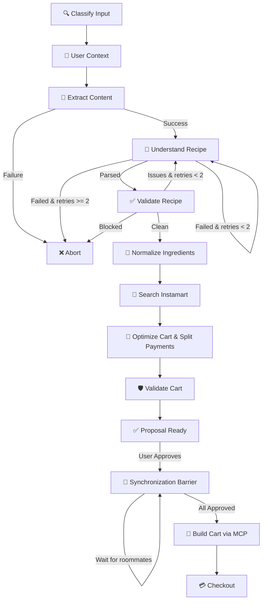

# 🍳 InstaChef AI — Cooking Commerce Agent

**Turn any recipe video, blog, or text into a real Swiggy Instamart grocery order, now with multi-tenant group checkout.**

InstaChef AI is a **10-node agentic pipeline** that watches a YouTube video, reads an Instagram Reel, parses a recipe blog, or accepts raw text — then autonomously extracts ingredients, normalizes quantities, searches Instamart via semantic matching, optimizes your cart for minimal waste, handles fractional payment splits, and places the order. All in under 30 seconds.

---

## ✨ Why This Exists

You're watching a cooking video. The recipe looks amazing. You want to try it tonight. But:
- You pause the video, copy the ingredient list
- Open Swiggy Instamart
- Search for each ingredient one by one
- Figure out the right pack sizes (200g paneer? 500g?)
- Realize you already have turmeric and salt at home
- Figure out who owes what if you're cooking with roommates
- Place the order 20 minutes later

**InstaChef AI does all of this in one click.**

---

## 🧠 Architecture — A Real Agentic Pipeline

This is **not** a wrapper around an LLM prompt. It's a production-grade state machine built on **LangGraph** with conditional routing, validation gates, retry loops, synchronization barriers, and human-in-the-loop checkpoints.



### 10 Pipeline Nodes

| # | Node | What It Does |
|---|------|-------------|
| 1 | **Classify** | Detects input type: YouTube, Instagram Reel, blog URL, or raw text |
| 2 | **User Context** | Fetches order history, go-to items, brand preferences, dietary signals via Swiggy MCP |
| 3 | **Extract** | 3-tier fallback for YouTube, **Instaloader** and GraphQL for Instagram, `recipe-scrapers` for blogs |
| 4 | **Understand** | LLM recipe parsing with multi-provider fallback (NVIDIA NIM → Gemini). Explicit Indian language translation. |
| 5 | **Validate Recipe** | Auto-repair gate: deduplication, quantity capping, core-ingredient heuristics |
| 6 | **Normalize** | Unit conversion (g/ml/tsp/tbsp/cups/kg) |
| 7 | **Search Instamart** | 8× parallel product search via Swiggy MCP |
| 8 | **Optimize** | **Semantic vector matching (Cosine Similarity)**, pack-size efficiency, low-volume penalty, brand preference tie-breakers, and **HostelSync fractional splits** |
| 9 | **Validate Cart** | Final validation gate: budget sanity, coverage check, waste analysis |
| 10| **Checkout** | Real cart building + order placement via Swiggy MCP OAuth 2.1 |

---

## 🔥 Key Differentiators

### Semantic Matching & Precision
Replaced legacy text-overlap matching with robust **Cosine Similarity (`all-MiniLM-L6-v2` via `sentence-transformers`)**. Added a **Unit Discrepancy Penalty** that aggressively penalizes bulk items (e.g., 1kg packs) when a recipe specifically requests low-volume units (e.g., a "pinch" or "tsp").

### HostelSync Fractional Ordering
Built natively into the LangGraph state machine, HostelSync allows groups to order together. The graph calculates proportional splits dynamically and halts at a **Synchronization Barrier** using LangGraph's checkpointer (`MemorySaver`). It waits for all roommates to submit their approval via SSE signals before proceeding to build the cart and checkout.

### Pantry Intelligence & Waste Minimization
> "We picked 200g paneer instead of 500g because you only need 150g — saving ₹80 and 60% waste."

The pipeline detects pantry staples (skips items like salt and oil) and scores every product for pack-size efficiency to minimize food waste. 

### Multi-Provider Resilience & Extraction
- **LLMs**: Primary NVIDIA NIM (Llama 3.1 8B), fallback Google Gemini 2.0 Flash.
- **Instagram**: Implemented robust fallbacks including GraphQL and an `instaloader` context wrapper to bypass login walls.

---

## 🛠 Tech Stack

| Layer | Technology |
|-------|-----------|
| **Orchestration** | LangGraph (State machine + Checkpointer) |
| **Backend** | FastAPI + Uvicorn |
| **Frontend** | Next.js 14 + Tailwind CSS (Glassmorphism & Cinematic Typography) |
| **LLM** | NVIDIA NIM + Gemini 2.0 Flash |
| **Semantic Search** | `sentence-transformers` + ChromaDB / In-memory cosine similarity |
| **Commerce** | Swiggy MCP (OAuth 2.1, JSON-RPC 2.0) |
| **Social Extraction** | `instaloader`, `yt-dlp`, `youtube-transcript-api` |

---

## 🚀 How to Run Locally

### Prerequisites
- Python 3.12+
- Node.js 20+

### Step 1 — Backend setup
```bash
cd backend
python -m venv venv
# Windows:
venv\Scripts\activate
# Mac/Linux:
source venv/bin/activate

pip install -r requirements.txt
```

### Step 2 — Configure API keys
Copy `backend/.env` and fill in your keys:
```env
NVIDIA_API_KEY=your_nvidia_nim_key
MOCK_MCP=True  # Set to false to use real Swiggy creds
```

### Step 3 — Start backend
```bash
cd backend
venv\Scripts\python.exe -m uvicorn app.main:app --reload --port 8000
```

### Step 4 — Frontend
```bash
cd frontend
npm install
npm run dev
```

Navigate to [http://localhost:3000](http://localhost:3000).

---

## 📄 License
Built for the Swiggy Builders Club Hackathon 2026.
